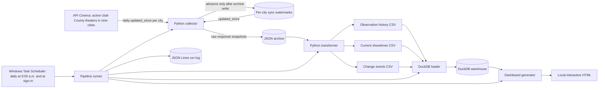

# Pipeline Architecture and Recovery Plan

## Recovery and history

- A successful request that returns no rows is a healthy empty delta. It still advances the saved watermark and writes a raw snapshot.
- If the API request or a later stage fails, the run is logged. The collector only advances its watermark after the raw response is saved, so the next successful run continues from the previous checkpoint.
- The API keeps removal records for 30 days. If a saved watermark is older than 30 days or is in the future, the collector performs a full sync for that city to rebuild current state. The local raw archive and historical tables are retained.
- The raw archive is the replay source. The transformer can rebuild the CSV outputs from it, and the warehouse loader uses unique keys to avoid duplicating observations and change events.
- The task runs at 9:00 a.m. and also at user sign-in. The runner checks the run log and skips a second scheduled collection after a successful run on the same Mountain Time date. This sign-in trigger catches up after the computer was unavailable at 9:00 a.m.; the task does not wake a powered-off or sleeping computer.

## Scope and known limits

The first full import is the available upcoming schedule, not a multi-year history seed. From then on, the project keeps the records and changes it observes. The source's own US programs refresh every one to three days and its showtime endpoint does not provide ticket prices. This source and cadence therefore depend on the instructor's approval under the assignment's alternate-source rule.
